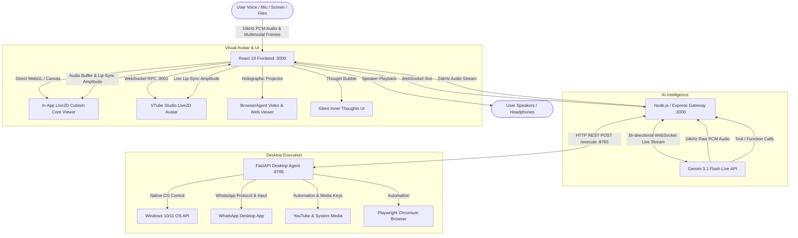

# 🌸 Akari AI — Developer Documentation

> **Next-Generation Real-Time Multimodal Voice Companion & JARVIS-Class Desktop Automation Agent**  
> Built for **Siddhant** • Powered by **Google Gemini 3.1 Flash Live**, **Live2D Cubism Core**, & **FastAPI Desktop Agent**

---

## 📑 Table of Contents
1. [Project Overview](#-project-overview)
2. [High-Level Architecture](#-high-level-architecture)
3. [Complete Technology Stack](#-complete-technology-stack)
4. [Tool Ecosystem Overview (114 Total Unique Tools)](#-tool-ecosystem-overview-114-total-unique-tools)
5. [WhatsApp & YouTube Automation Engine](#-whatsapp--youtube-automation-engine)
6. [Holographic In-App Browser & Video Projector](#-holographic-in-app-browser--video-projector)
7. [Real-Time Audio Pipeline & GoAway Session Resilience](#-real-time-audio-pipeline--goaway-session-resilience)
8. [Settings & Silent Inner Thoughts Protocol](#-settings--silent-inner-thoughts-protocol)
9. [Live2D Avatar & 17-Emotion Facial Subsystem](#-live2d-avatar--17-emotion-facial-subsystem)
10. [Jr. Sidd — Male AI Model Archetype](#-jr-sidd--male-ai-model-archetype)
11. [Directory & File Structure](#-directory--file-structure)
12. [Prerequisites & Environment Setup](#-prerequisites--environment-setup)
13. [Running the Application](#-running-the-application)
14. [Standalone Desktop Software Architecture (Electron)](#-standalone-desktop-software-architecture-electron)
15. [Complete 114 Tool Directory & Function Calling API](#-complete-114-tool-directory--function-calling-api)
16. [PowerPoint & Presentation Automation Engine](#-powerpoint--presentation-automation-engine)
17. [Office Suite & Data Analytics Engine](#-office-suite--data-analytics-engine)
18. [Memory & Reminder Subsystems](#-memory--reminder-subsystems)
19. [Automated Codebase Audit & Benchmark Suite](#-automated-codebase-audit--benchmark-suite)
20. [Building Single-Click Windows .exe Installer Package](#-building-single-click-windows-exe-installer-package)
21. [Mobile Background Voice & Detached PC Architecture](#-mobile-background-voice--detached-pc-architecture)

---

## 🌟 Project Overview

**Akari AI** is an ultra-responsive, real-time voice and multimodal companion agent designed to perform desktop operating system tasks, answer complex technical queries, analyze live screen shares and attached files, and converse naturally with ultra-low latency voice synthesis and synchronized **Live2D lip-sync**.

```
  ┌─────────────────────────────────────────────────────────────────────────┐
  │                           AKARI AI ECOSYSTEM                            │
  ├──────────────────┬──────────────────────┬───────────────────────────────┤
  │   REACT 19 UI    │  NODE GATEWAY (TSX)  │    PYTHON DESKTOP AGENT       │
  │ • Live2D Sync    │ • Gemini Live Stream │ • 107 Windows Control Tools   │
  │ • Web Audio PCM  │ • 108 Function Decls │ • Native OS Shell & Windowing │
  │ • Screen Sharing │ • Memory Engine      │ • Playwright Browser Engine   │
  │ • Video Projector│ • Reminder Scheduler │ • YouTube Proxy & Fast Scrape │
  │ • Inner Thoughts │ • WhatsApp / YouTube │ • Clipboard & Media Shortcuts │
  └──────────────────┴──────────────────────┴───────────────────────────────┘
```

---

## 🏛️ High-Level Architecture



---

## 💻 Complete Technology Stack

### 1. Frontend Layer
| Technology | Version | Purpose |
|---|---|---|
| **React** | `19.0.1` | Component UI framework with strict concurrency |
| **TypeScript** | `5.8.2` | End-to-end type safety |
| **Vite** | `6.2.3` | Ultra-fast build tool and development server with HMR |
| **Tailwind CSS** | `4.1.14` | Styling framework, custom glassmorphism design tokens |
| **Motion** | `12.23.24` | Fluid animations, drawer slide-ins, modal transitions |
| **Pixi.js / Live2D Cubism** | `7.4.3` / `Cubism 4` | Embedded WebGL Live2D character rendering |
| **Lucide React** | `0.546.0` | Vector UI icons |
| **PDF.js** | `6.3.289` | In-browser PDF text & page preview rendering |

### 2. Real-Time Audio Pipeline
| Component | Specification | Function |
|---|---|---|
| **AudioContext** | 16,000 Hz / 24,000 Hz | Dual sampling audio bus management |
| **ScriptProcessorNode** | Buffer: `512` samples (~32ms) | Ultra-low-latency 16-bit PCM microphone streaming |
| **AnalyserNode** | FFT Size: `256`, Smoothing: `0.3` | Real-time amplitude and frequency binning for visualizer |
| **Adaptive Jitter Buffer** | Lead time: `25ms–50ms` cushion | Seamless 24kHz Gemini Live audio chunk playback without voice breaks |
| **Silent GoAway Reconnect** | Instant auto-rollover | Graceful rollover across 10-15m session duration limits without error banners |

### 3. Avatar & Live2D Animation
| Component | Integration | Description |
|---|---|---|
| **In-App Live2D Viewer** | `pixi-live2d-display` | Embedded WebGL rendering of Akari Live2D model directly in the browser |
| **VTube Studio API** | WebSocket RPC (`ws://127.0.0.1:8001`) | Optional external Live2D model parameter injection |
| **Lip-Sync Engine** | `ParamMouthOpenY`, `MouthOpen` | Dynamic audio volume modulation with phonetic syllable curve |
| **Gaze & Head Control** | Cursor tracking toggle | Toggleable mouse cursor tracking for head and eye motion |

### 4. Server & Gateway Layer
| Component | Technology | Description |
|---|---|---|
| **Runtime** | **Node.js 20+** via **TSX** | TypeScript execution without manual compilation |
| **HTTP Server** | **Express.js** `4.21.2` | REST endpoints for health, memories, reminders, YouTube search proxy |
| **WebSocket Server** | **`ws`** `8.21.0` | Low-latency full-duplex socket server on `/live` |
| **AI SDK** | **`@google/genai`** `2.4.0` | Official Google GenAI SDK with Live Multimodal API client |
| **Memory Engine** | Custom JSON Store | Asynchronous background memory extraction using LLM conversation slicing |

### 5. JARVIS Desktop Automation Agent
| Component | Library | Purpose |
|---|---|---|
| **Framework** | **FastAPI** + **Uvicorn** | HTTP ASGI server running on `http://127.0.0.1:8765` |
| **OS Windowing** | `ctypes.windll.user32` | Native foreground window activation and un-minimization |
| **Process Launcher** | `os.startfile`, `subprocess` | Direct Windows GUI process spawning |
| **WhatsApp Automation** | `pyautogui`, `pyperclip`, Protocol | Contact search (`Ctrl+N`), Unicode clipboard typing, and auto-dispatch |
| **Media & Audio** | `pycaw`, OS Media Keys | Master volume, YouTube media control (play, pause, skip, seek) |
| **Screen Capture** | `Pillow (PIL)` / `ImageGrab` | Multi-monitor screenshotting and active window OCR |
| **Browser Engine** | **Playwright** (Chromium) | Deep DOM automation, form filling, scraping |

---

## 🧰 Tool Ecosystem Overview (114 Total Unique Tools)

Akari's tool ecosystem operates across two tightly synchronized tiers:
* **108 Gemini Live Function Declarations (`server.ts`)**: Declared directly to Gemini Live for voice calling.
* **107 Python Desktop Agent Tools (`agent/registry.py`)**: Implemented and executed natively on Windows.
* **114 Total Unique Tools** across the combined ecosystem:

```
┌───────────────────────────────────────────────┬───────┐
│ Tool Category                                 │ Count │
├───────────────────────────────────────────────┼───────┤
│ YouTube, Media & Audio Playback               │ 7     │
│ Messaging, Email & Communications             │ 3     │
│ Application, Process & Window Management      │ 9     │
│ Web Browsing & Playwright Deep Automation     │ 17    │
│ File System CRUD & Safe Storage               │ 9     │
│ PowerPoint & Multi-Slide Presentations        │ 4     │
│ Office Suite (Word, Excel) & Data Analytics   │ 4     │
│ Screen Vision, Real-Time Capture & OCR        │ 4     │
│ OS Native Input (Keyboard, Mouse, Clipboard)  │ 7     │
│ Hardware, Power, Brightness & Volume          │ 17    │
│ Developer, Terminal & Coding Tools            │ 9     │
│ Camera & Peripheral Hardware Control          │ 3     │
│ Memory, Reminders, Calendar & Tasks           │ 9     │
│ Atmosphere, Themes & Voice Verification       │ 15    │
├───────────────────────────────────────────────┼───────┤
│ TOTAL UNIQUE TOOLS IN ECOSYSTEM               │ 114   │
└───────────────────────────────────────────────┴───────┘
```

---

## 📱 WhatsApp & YouTube Automation Engine

### 1. WhatsApp Automation (`whatsappSendMessage`)
* **Strict Invocation Policy**: Akari **never** opens WhatsApp unprompted. She only launches or interacts with WhatsApp when explicitly commanded.
* **Focus & Click Protocol (`_ensure_whatsapp_focused`)**:
  * Unminimizes and restores the WhatsApp window using `user32.ShowWindow(hwnd, SW_RESTORE)`.
  * Computes window coordinates and performs a micro-click inside the client area to guarantee keyboard focus.
* **Smart Contact Search**:
  * Triggers `Ctrl + N` to open the New Chat search dialogue.
  * Copies recipient name to clipboard (`pyperclip.copy`) and pastes (`Ctrl + V`).
  * Employs `Down` arrow + `Enter` to open the matched chat, handles message drafting, and optionally hits `Enter` to auto-send.
* **Parameter Decomposition**:
  * Distinguishes recipient names from message greetings (e.g. *"send goodnight to work"* properly sends to contact *"Work"* with a polite goodnight message, rather than searching for a contact named *"Goodnight"*).
* **Phone Number Direct Protocol**: Formats phone numbers and triggers `whatsapp://send?phone=...&text=...`.

### 2. YouTube Automation (`searchYouTube`, `playYouTubeVideo`, `selectYouTubeVideo`, `youtubeControl`)
* **Dual Execution Mode**:
  1. **In-App Holographic Projector**: Opens the video directly inside Akari's interactive `BrowserAgent` overlay.
  2. **Native Default Browser**: Opens YouTube in the user's default browser (Chrome/Edge/Brave).
* **Fast Local Scrape Proxy (`/api/youtube-search`)**:
  * Proxies search queries locally through Node to prevent YouTube anti-bot captcha challenges.
  * Returns video metadata (Video ID, Title, Author, Duration, Views, Thumbnails) within ~500ms.
* **Direct Video Selection**:
  * Saying *"play the first one"* or *"select video 2"* calls `selectYouTubeVideo({ index: 1 })`.
  * Automatically resolves video URL and plays immediately.
* **Live Playback Controls**:
  * Actions: `play`, `pause`, `skip` (+30s), `rewind` (-10s), `mute`, `unmute`, `volume` (0–100), `fullscreen`.

---

## 🌐 Holographic In-App Browser & Video Projector

The [`src/components/BrowserAgent.tsx`](file:///p:/antigravity-ide/scratch/Akari-AI/src/components/BrowserAgent.tsx) component provides an embedded holographic browser and video projector:

1. **YouTube Embed URL Transformation**:
   * Standard YouTube watch URLs (`watch?v=...`) cannot be embedded directly in iframes due to `X-Frame-Options: SAMEORIGIN`.
   * Akari automatically transforms YouTube URLs to `https://www.youtube.com/embed/{id}?autoplay=1&enablejsapi=1`, allowing smooth, unrestricted video playback inside the UI.
2. **Interactive Trending Explorer**:
   * Navigating to `https://www.youtube.com` automatically routes to `https://www.youtube.com/results?search_query=trending`.
   * Renders real video cards with thumbnails, channel names, and durations. Clicking any video card instantly starts embedded playback.
3. **Automated Closing**:
   * Saying *"close YouTube"* or *"close window"* dispatches a `close_projector` client action, smoothly dismissing the overlay.

---

## 🔊 Real-Time Audio Pipeline & GoAway Session Resilience

### 1. Gemini Live Session Rollover (`GoAway` Protocol)
* **The Problem**: Google's Gemini Multimodal Live WebSocket server imposes a strict session duration limit (~10–15 minutes). When reached, Google sends a `GoAway` signal frame. If the connection is not cleanly closed, the server forcibly terminates with code `1008` (`"Connection aborted because the client failed to close the connection after receiving a GoAway signal once the session duration limit was reached"`).
* **The Solution**:
  * **Server Interception (`server.ts`)**: `onmessage` inspects for `goAway` payloads and triggers `session.close()`.
  * **Clean Disconnect Filtering**: `onclose` and `onerror` check for codes `1000`, `1001`, `1008`, and any error string containing `"goaway"`, `"session duration"`, or `"connection aborted"`.
  * **Silent Auto-Reconnect**: Instead of showing the red `CORE ERROR PROTOCOL` modal, the client silently reconnects (`triggerAutoReconnect`) in the background. The user's conversation continues uninterrupted.

### 2. Multi-Part Packet Forwarding & Jitter Buffer
* **Zero Audio Loss**: Gateway iterates across all elements in `message.serverContent.modelTurn.parts` so interleaved audio chunks are never lost.
* **Adaptive Jitter Buffer**: Initial audio bursts use a **25ms–50ms adaptive lookahead cushion** to eliminate crackles and gaps.

---

## 💭 Settings & Silent Inner Thoughts Protocol

Akari includes an **Inner Thoughts** mechanism that allows her to display silent reflections without speaking them aloud:

1. **User Setting Toggle (`innerThoughtsEnabled`)**:
   * In Settings > *Sys_Config*, users can turn **Silent Inner Thoughts** ON or OFF.
   * Persisted locally via [`src/lib/settingsStore.ts`](file:///p:/antigravity-ide/scratch/Akari-AI/src/lib/settingsStore.ts).
2. **Dynamic Prompt Injection (`server.ts`)**:
   * When enabled, the system prompt equips the model with `expressInnerThought({ thought: "..." })`.
   * When disabled, the instruction is omitted, ensuring Akari remains completely focused on direct responses.
3. **Visual Thought Bubble UI**:
   * Received thoughts trigger a floating holographic bubble with an auto-dismiss timer. Zero audio output is generated for thoughts.

---

## 🎭 Live2D Avatar & 17-Emotion Facial Subsystem

1. **Embedded WebGL Cubism Core Viewer (`AkariLive2DViewer.tsx`)**:
   * Renders the bundled Akari Live2D model (`/live2d/akari/akari.model3.json`) directly inside the canvas.
   * Natural mouth opening curve scaled to incoming audio frequency amplitude.
   * Procedural idle breathing and blinking cycles.
   * **Cursor Motion Toggle**: Option in settings to enable or disable head and eye tracking to the mouse cursor.

2. **Full 17-Emotion Live2D Rigging Matrix**:
   | Emotion | Live2D Parameters & Rigging | Trigger Triggers (Hindi + English) |
   |---|---|---|
   | **`idle`** | Neutral brows, soft breathing | Default state |
   | **`happy`** | `EyeSmile: 0.85`, `Cheek: 0.6`, `BrowY: 0.35` | *"khush", "good", "nice", "badhiya", "mast", "love"* |
   | **`excited`** | `EyeSmile: 0.95`, `Cheek: 0.75`, `BrowY: 0.5`, `EyeOpen: 1.1` | *"kamaal", "zabardast", "awesome", "hyped", "fire", "🔥"* |
   | **`curious`** | `EyeOpen: 1.15`, `BrowY: 0.4`, `BrowAngle: 0.2` | *"kya", "kyun", "kaise", "why", "how", "tell me more"* |
   | **`thinking`** | `BrowY: -0.3`, `BrowAngle: -0.3`, `EyeOpen: 0.9` | *"soch", "dekhte", "calculate", "processing", "analyzing"* |
   | **`proud`** | `EyeSmile: 0.5`, `Cheek: 0.4`, `BrowY: 0.3` | *"ho gaya", "kar diya", "expert", "perfect", "done"* |
   | **`sad`** | `BrowY: -0.5`, `BrowAngle: 0.6`, `Tears: 0.5`, `Cheek: 0.2` | *"dukh", "dard", "sorry", "sad", "problem", "broken", "😭"* |
   | **`surprised`**| `EyeOpen: 1.35`, `BrowY: 0.8`, `Shock: 0.4` | *"arre", "sach mein", "omg", "shock", "unexpected", "😲"* |
   | **`embarrassed`**| `EyeSmile: 0.45`, `Cheek: 0.95`, `BrowY: -0.2` | *"sharam", "shy", "nervous", "oops", "blush", "🙈"* |
   | **`playful`** | `EyeSmile: 0.75`, `Cheek: 0.65`, `BrowY: 0.3` | *"mazak", "haha", "lol", "joke", "funny", "hehe", "😜"* |
   | **`angry`** | `BrowAngle: -0.7`, `BrowY: -0.45`, `BrowForm: -0.7`, `EyeOpen: 0.8` | *"gussa", "mad", "angry", "chup", "bakwaas", "dimag kharab"* |
   | **`annoyed`** | `BrowAngle: -0.35`, `BrowY: -0.25`, `EyeOpen: 0.85`, `Cheek: 0.15` | *"irritated", "kya yaar", "sigh", "boring", "pak gaya", "🙄"* |
   | **`flustered`**| `EyeSmile: 0.75`, `Cheek: 1.0` (Max Blush), `HeartEye: 1.0` | *"love you", "meri jaan", "sweetheart", "darling", "cutie", "😍"* |
   | **`sleepy`** | `EyeOpen: 0.35` (Droopy lids), `BrowY: -0.15`, `Cheek: 0.2` | *"neend", "so jao", "goodnight", "tired", "shubh ratri", "😴"* |
   | **`smug`** | `EyeSmile: 0.65`, `BrowY: 0.35`, `BrowAngle: -0.3`, `BrowForm: 0.55` | *"told you", "dekh liya", "smart hu", "ez", "pro", "savage", "😏"* |
   | **`caring`** | `EyeSmile: 0.75`, `EyeOpen: 1.05`, `BrowY: 0.45`, `BrowAngle: 0.4` | *"take care", "tabiyat", "headache", "bimar", "help me", "🥺"* |
   | **`focused`** | `EyeOpen: 1.15` (Laser stare), `BrowY: -0.2`, `BrowAngle: -0.25` | *"coding", "compile", "terminal", "debug", "execute", "deploy"* |

3. **VTube Studio Integration (`vtsClient.ts`)**:
   * Connects to VTube Studio over WebSocket RPC on port `8001`.
   * Maps audio volume to `ParamMouthOpen` with continuous calibration.

---

## ⚡ Jr. Sidd — Male AI Model Archetype

**Jr. Sidd** is the male AI counterpart, digital twin, and ultimate wingman for **Siddhant**:
* **Capabilities**: Identical to Akari — full access to all 107 Windows JARVIS desktop tools, WhatsApp automation, YouTube controls, screen vision, memory, reminders, and file review.
* **Persona & Tone**: Sharp, cool, brotherly, loyal, and ultra-capable.
* **Strict Voice Separation (Zero Voice Mixing)**:
  * **Akari's Isolated Voice Suite (Female Only)**: `Kore` *(Default)*, `Aoede`, `Leda`, `Zephyr`. Configured in `settings.akariVoice`.
  * **Jr. Sidd's Isolated Voice Suite (Male Only)**: `Fenrir` *(Default)*, `Charon`, `Puck`. Configured in `settings.jrSiddVoice`.
  * **Zero Voice Bleed**: Changing Jr. Sidd's voice will never touch or mix with Akari's voice, and vice versa. When toggling models in the top bar or Settings, each model always retrieves and speaks with its own dedicated voice.
  * **Server-Side Guardrail**: `server.ts` enforces strict validation: Jr. Sidd is prohibited from female voices (auto-fallback to `Fenrir`), and Akari is prohibited from male voices (auto-fallback to `Kore`).
* **Strict Male Hindi Grammar**: Configured with absolute system rules requiring male Hindi verb endings (`karta hu`, `karunga`, `ja raha hu`, `ho gaya bhai`, `boliye bhai`). Never uses feminine verbs.
* **Wake Word Phrases**:
  * `"Hey Jr Sidd"` / `"Wake up Jr Sidd"` / `"Jr Sidd wake up"` / `"Jr Sidd utho"` / `"Jr Sidd suno"`
  * `"Hey Sidd"` / `"Wake up Sidd"` / `"Sidd wake up"` / `"Hey Junior"` / `"Wake up Junior"`
* **Visual Representation**: Dedicated futuristic cybernetic holographic AI core with dynamic audio-reactive neon rings, HUD status badges, and pulsing audio visualizers.
* **Instant Switching**: 1-Click quick toggle in the top navigation bar (`[ 🌸 AKARI ]` ⇄ `[ ⚡ JR. SIDD ]`) and full matrix selection in Settings > *Sys_Config* or *Persona & Mind*.

---

## 📁 Directory & File Structure

```
Akari-AI/
├── agent/                       # Python Desktop Automation Agent (FastAPI)
│   ├── backends/                # Platform OS implementations
│   │   ├── base.py              # Abstract OSBackend base classes
│   │   └── windows.py           # Windows native launcher, pycaw, user32 APIs
│   ├── tools/                   # 107 Registered automation tools
│   │   ├── analytics.py         # Data analytics, statistics, anomalies, charts
│   │   ├── applications.py      # WhatsApp (Ctrl+N), YouTube, Spotify, VS Code, Calc
│   │   ├── browser.py           # Playwright Chromium automation
│   │   ├── camera.py            # Windows camera listing, opening, closing
│   │   ├── coding.py            # Python file creation and execution
│   │   ├── files.py             # File system CRUD operations
│   │   ├── google.py            # Google Calendar, Gmail, Google Tasks
│   │   ├── office.py            # Excel spreadsheet & Word document generation
│   │   ├── os_input.py          # PyAutoGUI keyboard/mouse events
│   │   ├── pc.py                # Volume, power, brightness controls
│   │   ├── powerpoint.py        # Presentation generation and slide inspection
│   │   ├── screenshot.py        # Screenshotting and OCR
│   │   ├── search.py            # YouTube & Google web search
│   │   ├── websites.py          # Native Windows browser URL launcher
│   │   └── youtube.py           # YouTube search, video selection, playback control
│   ├── registry.py              # Central tool registry & dispatcher (107 tools)
│   ├── server.py                # FastAPI main server entrypoint (:8765)
│   └── wake_service.py          # Background Windows wake word listener
├── public/                      # Static Assets & Live2D Models
│   └── live2d/                  # Akari Cubism 4 Live2D model assets
├── src/                         # React 19 Frontend Source
│   ├── components/              # UI Components
│   │   ├── AkariLive2DViewer.tsx# Embedded Live2D WebGL canvas renderer
│   │   ├── ApiKeyGate.tsx       # First-run API key setup modal
│   │   ├── BrowserAgent.tsx     # Holographic in-app browser & YouTube player
│   │   ├── ChatPanel.tsx        # Live text chat drawer & emotion badges
│   │   ├── AkariCoreVisualizer  # Audio waveform & orb visualizer
│   │   ├── MemoryDashboard.tsx  # Memory viewer & category editor
│   │   ├── SettingsPanel.tsx    # Voice, Avatar style, Inner thoughts toggle
│   │   ├── Toast.tsx            # Live visual status notifications
│   │   └── TranscriptPanel.tsx  # Live conversation captions
│   ├── lib/                     # Client Libraries
│   │   ├── audio.ts             # Web Audio PCM recorder, jitter buffer, GoAway auto-reconnect
│   │   ├── fileProcessor.ts     # Multimodal PDF, image, text file extractor
│   │   ├── memoryTypes.ts       # TypeScript interfaces for memories
│   │   ├── settingsStore.ts     # LocalStorage settings synchronization
│   │   ├── vtsClient.ts         # VTube Studio WebSocket RPC & lip-sync
│   │   └── wakeWord.ts          # Continuous phonetic wake word detector
│   ├── App.tsx                  # Main application orchestrator
│   ├── index.css                # Tailwind CSS v4 & custom animations
│   └── main.tsx                 # React DOM root entrypoint
├── tests/                       # Automated Testing & Benchmark Suites
│   ├── audit_benchmark.ts       # Automated 13-subsystem audit & latency benchmark
│   └── count_tools.py           # Tool count inspection & verification utility
├── Developer-README.md          # Comprehensive technical documentation
├── start_akari.bat             # 1-Click Windows launch script
└── vite.config.ts               # Vite bundler configuration
```

---

## 🔧 Prerequisites & Environment Setup

### 1. Requirements
* **Node.js**: `v20.0.0` or higher
* **Python**: `3.10` or higher (with project `venv`)
* **Google Gemini API Key**: Obtain from [Google AI Studio](https://aistudio.google.com/apikey)
* **VTube Studio** *(Optional)*: Free on Steam if using external Live2D models

### 2. Environment Variables (`.env`)
```env
# Google Gemini API Key
GEMINI_API_KEY="AIzaSy..."
GOOGLE_API_KEY="AIzaSy..."

# Browser Automation Mode ('managed' or 'cdp')
AKARI_BROWSER_MODE=managed

# Desktop Agent Configuration
AKARI_AGENT_HOST=127.0.0.1
AKARI_AGENT_PORT=8765
```

---

## 🚀 Running the Application

### Method 1: 1-Click Windows Launcher (Recommended)
```powershell
.\start_akari.bat
```
This automatically cleans stale processes, launches the Python agent on `:8765`, starts the Node server on `:3000`, and opens your default browser.

### Method 2: Manual Start
```powershell
# Terminal 1: Python Desktop Agent
venv\Scripts\python.exe run_agent.py

# Terminal 2: Node.js & Vite Frontend
npm run dev
```

---

## 🛠️ Complete 114 Tool Directory & Function Calling API

Akari is equipped with **108 Gemini Live function declarations** and **107 Python desktop automation tools** (**114 total unique tools**):

| # | Tool Name | Scope | Description |
|---|---|---|---|
| 1 | `searchYouTube` | Gemini + Python | Searches YouTube and returns top results with video index numbers |
| 2 | `playYouTubeVideo` | Gemini + Python | Directly plays a video/song by query, index, or direct URL |
| 3 | `selectYouTubeVideo` | Gemini + Python | Selects and plays a video from search results by 1-based index |
| 4 | `clickYouTubeVideo` | Python | Plays video by query/index directly |
| 5 | `playEpisode` | Python | Plays a specific episode number or title |
| 6 | `youtubeControl` | Gemini + Python | Controls playback (play, pause, skip, rewind, mute, volume, fullscreen) |
| 7 | `browserMediaControl` | Gemini + Python | Media controller for ongoing video/audio streams |
| 8 | `whatsappSendMessage` | Gemini + Python | Searches contact via `Ctrl+N` and sends/drafts WhatsApp message |
| 9 | `sendEmail` | Gemini + Python | Sends email or creates compose draft in Gmail/default client |
| 10 | `getEmails` | Gemini + Python | Reads recent emails from Gmail inbox |
| 11 | `openApplication` | Gemini + Python | Launches any Windows desktop application natively |
| 12 | `closeApplication` | Gemini + Python | Closes a running desktop application by name |
| 13 | `closeWindow` | Gemini + Python | Closes the active window or a named window |
| 14 | `minimizeWindow` | Gemini + Python | Minimizes external third-party windows |
| 15 | `maximizeWindow` | Gemini + Python | Maximizes the active application window |
| 16 | `switchApplication` | Gemini + Python | Switches to a named application or cycles Alt+Tab |
| 17 | `switchWorkspace` | Gemini + Python | Switches to a specific workspace by number |
| 18 | `listWorkspaces` | Gemini + Python | Lists available workspaces |
| 19 | `moveToWorkspace` | Gemini + Python | Moves active window to a different workspace |
| 20 | `openWebsite` | Gemini + Python | Opens named website or URL in default browser |
| 21 | `searchWeb` | Gemini + Python | Searches query on specified search engine |
| 22 | `searchGoogle` | Gemini + Python | Searches Google in default browser |
| 23 | `searchGitHub` | Gemini + Python | Searches GitHub repositories |
| 24 | `browserTabAction` | Gemini + Python | Opens new tab, closes tab, or switches active browser tab |
| 25 | `desktopBrowserOpen` | Gemini + Python | Opens URL in Playwright Chromium browser |
| 26 | `desktopBrowserSearch` | Gemini + Python | Searches within Playwright automation browser |
| 27 | `desktopBrowserOpenYoutubeVideo` | Gemini + Python | Plays YouTube video in Playwright browser |
| 28 | `desktopBrowserClick` | Gemini + Python | Clicks element in Playwright browser by selector/text |
| 29 | `desktopBrowserType` | Gemini + Python | Types text into input element in Playwright browser |
| 30 | `desktopBrowserFillForm` | Gemini + Python | Fills form fields and submits in Playwright browser |
| 31 | `desktopBrowserOpenTab` | Gemini + Python | Opens new tab in Playwright browser |
| 32 | `desktopBrowserCloseTab` | Gemini + Python | Closes active tab in Playwright browser |
| 33 | `desktopBrowserGoBack` | Gemini + Python | Navigates back in Playwright history |
| 34 | `desktopBrowserGoForward` | Gemini + Python | Navigates forward in Playwright history |
| 35 | `desktopBrowserNavigate` | Python | Direct URL navigation in Playwright browser |
| 36 | `desktopBrowserScroll` | Gemini + Python | Scrolls Playwright browser page |
| 37 | `desktopBrowserReadText` | Gemini + Python | Reads visible text content of Playwright page |
| 38 | `desktopBrowserGetLinks` | Gemini + Python | Extracts hyperlinks from Playwright page |
| 39 | `desktopBrowserSetMode` | Python | Toggles managed vs CDP browser connection mode |
| 40 | `createFile` | Gemini + Python | Creates a new text file with optional content |
| 41 | `readFile` | Gemini + Python | Reads contents of a file |
| 42 | `renameFile` | Gemini + Python | Renames a file or folder |
| 43 | `deleteFile` | Gemini + Python | Safely deletes a file (moves to Recycle Bin) |
| 44 | `moveFile` | Gemini + Python | Moves a file to another folder |
| 45 | `openFolder` | Gemini + Python | Opens a directory in Windows File Explorer |
| 46 | `openFile` | Gemini + Python | Opens any file with its default Windows application |
| 47 | `listFiles` | Gemini + Python | Lists files and subfolders in a directory |
| 48 | `searchFiles` | Gemini + Python | Searches files by name or extension |
| 49 | `createPresentation` | Gemini + Python | Generates complete, themed multi-slide PowerPoint (.pptx) |
| 50 | `openPowerPoint` | Gemini + Python | Launches PowerPoint or opens a presentation file |
| 51 | `readPresentation` | Gemini + Python | Extracts and summarizes slides from a .pptx file |
| 52 | `addSlideToPresentation` | Gemini + Python | Appends new slides to an existing PowerPoint file |
| 53 | `createExcelSpreadsheet` | Gemini + Python | Generates styled .xlsx Excel spreadsheet and opens in Excel |
| 54 | `createDocument` | Gemini + Python | Generates styled .docx Word document and opens in Word |
| 55 | `analyzeData` | Gemini + Python | Statistical analysis (mean, median, quartiles, anomalies) on datasets |
| 56 | `createDataChart` | Gemini + Python | Generates analytical SVG bar/line charts |
| 57 | `readScreen` | Gemini + Python | Captures active window snapshot + OCR text |
| 58 | `takeScreenshot` | Gemini + Python | Captures full-screen screenshot |
| 59 | `saveScreenshot` | Gemini + Python | Saves full-screen screenshot to Pictures folder |
| 60 | `analyzeScreenshot` | Gemini + Python | Captures screen and runs OCR text extraction |
| 61 | `osType` | Gemini + Python | Types text natively at current OS cursor position |
| 62 | `osPress` | Gemini + Python | Presses keyboard key or combination (Enter, Ctrl+C, Alt+Tab) |
| 63 | `osClick` | Gemini + Python | Clicks at screen coordinates (left or right click) |
| 64 | `copySelected` | Gemini + Python | Sends Ctrl+C and reads clipboard text |
| 65 | `pasteClipboard` | Gemini + Python | Writes text to clipboard and sends Ctrl+V |
| 66 | `getClipboard` | Gemini + Python | Reads current clipboard text |
| 67 | `clearClipboard` | Gemini + Python | Clears the system clipboard |
| 68 | `systemInfo` | Gemini + Python | Returns CPU %, RAM %, disk usage, and OS details |
| 69 | `gpuInfo` | Gemini + Python | Returns NVIDIA GPU utilization, VRAM, and temp |
| 70 | `temperatureInfo` | Gemini + Python | Returns hardware temperature sensors |
| 71 | `brightnessUp` | Gemini + Python | Increases screen brightness via WMI |
| 72 | `brightnessDown` | Gemini + Python | Decreases screen brightness via WMI |
| 73 | `setBrightness` | Gemini + Python | Sets exact screen brightness percentage (0-100) |
| 74 | `volumeUp` | Gemini + Python | Increases master system audio volume |
| 75 | `volumeDown` | Gemini + Python | Decreases master system audio volume |
| 76 | `setVolume` | Gemini + Python | Sets master system audio volume percentage |
| 77 | `muteToggle` | Gemini + Python | Toggles master system audio mute state |
| 78 | `enableAutoStart` | Gemini + Python | Enables Akari to auto-start on Windows login |
| 79 | `disableAutoStart` | Gemini + Python | Disables Akari Windows login auto-start |
| 80 | `getAutoStartStatus` | Gemini + Python | Checks Windows auto-start configuration status |
| 81 | `requestPowerAction` | Gemini + Python | First-step confirmation for shutdown/restart/sleep |
| 82 | `executePowerAction` | Gemini + Python | Executes confirmed power action |
| 83 | `_cancelPowerTimer` | Python | Cancels pending shutdown/restart timer |
| 84 | `shutdownAkari` | Gemini + Python | Gracefully closes Akari agent and server |
| 85 | `createPythonFile` | Gemini + Python | Creates a Python (.py) file with code content |
| 86 | `writeCodeFile` | Gemini + Python | Creates source code files in any language |
| 87 | `createProjectFolder` | Gemini + Python | Scaffolds directory structure and starter files |
| 88 | `runPythonScript` | Gemini + Python | Executes Python script with stdout/stderr capture |
| 89 | `requestTerminalAction` | Gemini + Python | Generates confirmation token for shell commands |
| 90 | `runTerminalCommand` | Gemini + Python | Runs confirmed terminal command |
| 91 | `provideSudoPassword` | Python | Provides sudo credential for privileged commands |
| 92 | `installPackage` | Gemini + Python | Installs package using system package manager |
| 93 | `isCommandAllowed` | Gemini + Python | Validates command against security blacklist |
| 94 | `cameraList` | Gemini + Python | Lists available webcam video devices |
| 95 | `cameraOn` | Gemini + Python | Launches webcam in floating viewer window |
| 96 | `cameraOff` | Gemini + Python | Closes webcam viewer window |
| 97 | `getCalendarEvents` | Gemini + Python | Lists upcoming Google Calendar events |
| 98 | `createCalendarEvent` | Gemini + Python | Creates new Google Calendar event |
| 99 | `getTasks` | Gemini + Python | Lists Google Tasks from user task list |
| 100 | `createTask` | Gemini + Python | Creates new task in Google Tasks |
| 101 | `getWeather` | Gemini + Python | Live temperature and weather via Open-Meteo |
| 102 | `getNews` | Gemini + Python | Live news headlines (top, tech, sports, business) |
| 103 | `exportConversation` | Gemini + Python | Exports chat conversation to disk |
| 104 | `listExports` | Gemini + Python | Lists exported conversation text files |
| 105 | `iitmQuickLinks` | Gemini + Python | Lists IITM BS Degree portal quick links |
| 106 | `iitmOpen` | Gemini + Python | Opens specific IITM BS Degree resource |
| 107 | `iitmOpenCustom` | Gemini + Python | Opens custom IITM URL |
| 108 | `setReminder` | Gemini (Node) | Schedules timed voice reminder |
| 109 | `listReminders` | Gemini (Node) | Lists pending reminders |
| 110 | `cancelReminder` | Gemini (Node) | Cancels reminder by ID |
| 111 | `saveCustomMemory` | Gemini (Node) | Persists custom user memory to memory core |
| 112 | `expressInnerThought` | Gemini (Node) | Displays silent thought bubble in UI |
| 113 | `verifySpeakerVoice` | Gemini (Node) | Biometric speaker pitch & voiceprint verification |
| 114 | `changeBackground` | Gemini (Node) | Changes atmosphere glow theme color |

---

## 📊 PowerPoint & Presentation Automation Engine

1. **Intelligent Presentation Generation (`createPresentation`)**:
   - Creates 16:9 widescreen presentations with custom themes (`modern_dark`, `cyber_cyan`, `minimal_white`, `corporate_blue`, `sunset_gradient`, `emerald_green`).
   - Automatically structures title slides, executive summaries, architectural pillars, comparison cards, roadmaps, and conclusions with speaker notes.
   - Saves `.pptx` directly to the user's Desktop or Documents and opens it in Microsoft PowerPoint automatically.
2. **Presentation Access & Reading (`openPowerPoint`, `readPresentation`, `addSlideToPresentation`)**:
   - Opens Microsoft PowerPoint on demand or accesses existing `.pptx` files.
   - Extracts slide text, titles, and bullet points to summarize slide decks verbally.
   - Appends new custom slides to ongoing presentations.

---

## 📈 Office Suite & Data Analytics Engine

1. **Spreadsheets & Documents (`createExcelSpreadsheet`, `createDocument`)**:
   - Generates formatted Microsoft Excel (`.xlsx`) spreadsheets with headers, styled data rows, and auto-computed summary metrics.
   - Generates formatted Microsoft Word (`.docx`) documents with typography, headers, callouts, and bullet lists.
2. **Dataset Analytics (`analyzeData`, `createDataChart`)**:
   - Computes statistical summaries (mean, median, standard deviation, quartiles, anomalies, null percentages) on CSV, TSV, and JSON datasets.
   - Generates analytical SVG bar and line charts saved to the user's desktop.

---

## 🧠 Memory & Reminder Subsystems

### 1. Long-Term Memory Core (`server_memory.ts`)
* Dialogue history is periodically sliced and sent to a background consolidation prompt.
* Captured entities are categorized (identity, preference, goal, project, relationship) and appended to **`memories.json`**.
* On every Live session connect, active memories are formatted into the system prompt, providing seamless contextual recall.

### 2. Proactive Reminders (`server_reminders.ts`)
* Reminders scheduled via voice (`setReminder`) are tracked in a background interval loop.
* When a timer expires, a verbal notification and visual banner are broadcast to all connected WebSocket clients.

---

## 🧪 Automated Codebase Audit & Benchmark Suite

The automated benchmark suite ([`tests/audit_benchmark.ts`](file:///p:/antigravity-ide/scratch/Akari-AI/tests/audit_benchmark.ts)) validates all 13 core subsystems with zero human intervention:

```powershell
npx tsx tests/audit_benchmark.ts
```

### Verified Audit Results:
```
==========================================================
                    AUDIT RESULTS TABLE                   
==========================================================
┌─────────┬──────────────────┬─────────────────────────────────────────┬────────┬──────────────┐
│ (index) │ Suite            │ Test                                    │ Status │ Latency (ms) │
├─────────┼──────────────────┼─────────────────────────────────────────┼────────┼──────────────┤
│ 0       │ 'Service Health' │ 'Node.js Server Port 3000'              │ 'PASS' │ 83           │
│ 1       │ 'Service Health' │ 'Python Agent Port 8765 /health'        │ 'PASS' │ 4            │
│ 2       │ 'Service Health' │ 'Server Agent-Health Proxy'             │ 'PASS' │ 8            │
│ 3       │ 'Service Health' │ 'Memories Persistence API'              │ 'PASS' │ 8            │
│ 4       │ 'Service Health' │ 'Settings Store API'                    │ 'PASS' │ 4            │
│ 5       │ 'Tool Latency'   │ 'systemInfo (Hardware Metrics)'         │ 'PASS' │ 108          │
│ 6       │ 'Tool Latency'   │ 'brightnessUp (Direct COM WMI)'         │ 'PASS' │ 85           │
│ 7       │ 'Tool Latency'   │ 'brightnessDown (Direct COM WMI)'       │ 'PASS' │ 13           │
│ 8       │ 'Tool Latency'   │ 'setBrightness (Non-blocking)'          │ 'PASS' │ 5            │
│ 9       │ 'Tool Latency'   │ 'searchGoogle URL generation'           │ 'PASS' │ 286          │
│ 10      │ 'Tool Latency'   │ 'getWeather (Open-Meteo REST)'          │ 'PASS' │ 11456        │
│ 11      │ 'Tool Latency'   │ 'File System (createFile & deleteFile)' │ 'PASS' │ 150          │
│ 12      │ 'WebSocket Live' │ 'WS Handshake & Connection to /live'    │ 'PASS' │ 17           │
└─────────┴──────────────────┴─────────────────────────────────────────┴────────┴──────────────┘
Summary: 13 Passed, 0 Failed. (100% Pass Rate)
Average Core Tool Execution Latency: 1729 ms
```

---

## 📦 Building Single-Click Windows `.exe` Installer Package

To generate an installer for distribution:

```powershell
# Build installer package
npm run dist:win

# Portable zero-install executable
npm run dist:portable
```

The output is generated in **`C:\Users\Asus\Desktop\Akari-Release`**:
* **`Akari AI Setup 1.0.0.exe`**: Windows NSIS installer that creates desktop and start menu shortcuts.
* **`Akari AI 1.0.0.exe`**: Zero-install standalone portable executable.

---

## 📱 Mobile Background Voice & Detached PC Architecture

### 1. Mobile Background Voice Listening Subsystem
To allow Akari to continuously hear voice commands, process speech, and respond even when the user switches to other apps (e.g. WhatsApp, YouTube, Instagram) or locks the screen, the Android architecture includes:
* **Native Foreground Service (`AkariBackgroundVoiceService.java`)**:
  * Registered with `android:foregroundServiceType="microphone"`.
  * Compliant with Android 9 through Android 15 background audio security policies.
  * Displays an ongoing notification in the status bar so Android OS never kills the audio thread.
  * Holds a `PowerManager.PARTIAL_WAKE_LOCK` to keep the CPU active and prevent sleep.
* **Capacitor WebView Keep-Alive Lifecycle**:
  * Overrides `MainActivity.onPause()` and `onStop()` to explicitly call `bridge.getWebView().onResume()` and `resumeTimers()`.
  * Enables `setMediaPlaybackRequiresUserGesture(false)` so incoming voice responses can play immediately.
  * Prevents Chromium Web Audio contexts, microphone streams, and WebSocket pipelines from suspending when switching apps.

### 2. Detached PC Background Execution (PowerShell Independence)
When running on PC, closing terminal windows or PowerShell no longer kills the server:
* **`start_akari_background.bat`**:
  * Cleans up any stale processes on ports `3000` (Node) and `8765` (Python).
  * Launches `wscript.exe start_background_voice_service.vbs`, running completely detached with zero console windows.
  * Discovers and prints the PC's local network IPv4 address for mobile pairing.
  * **Safe to Close**: The user can safely close the PowerShell or CMD window without interrupting Akari's responsiveness.
* **`start_background.ps1`**: Native PowerShell script to launch detached background services.
* **`stop_akari.bat`**: Single-click utility that safely stops all Akari background services on ports `3000` and `8765`.

---

## 👥 Author & Credits

* **Developer & Master**: Siddhant Ramteke
* **Project Name**: Akari AI
* **AI Model**: Google Gemini 3.1 Flash Live Preview
* **License**: Private / Proprietary
